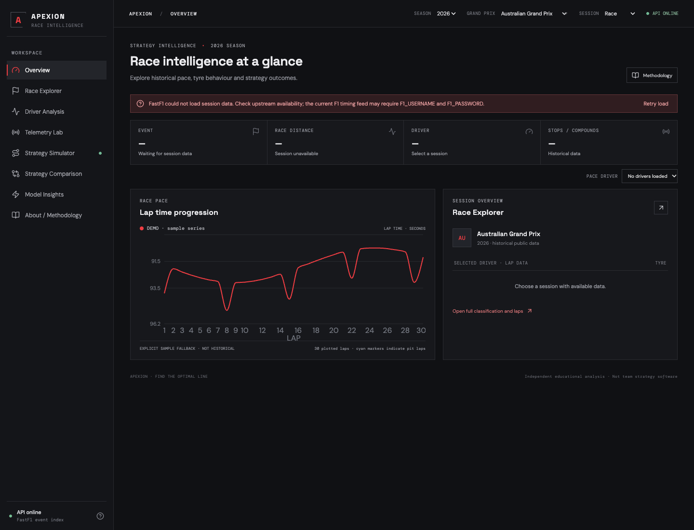
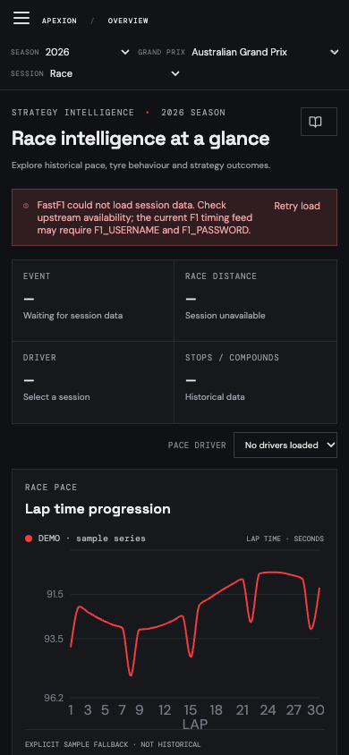
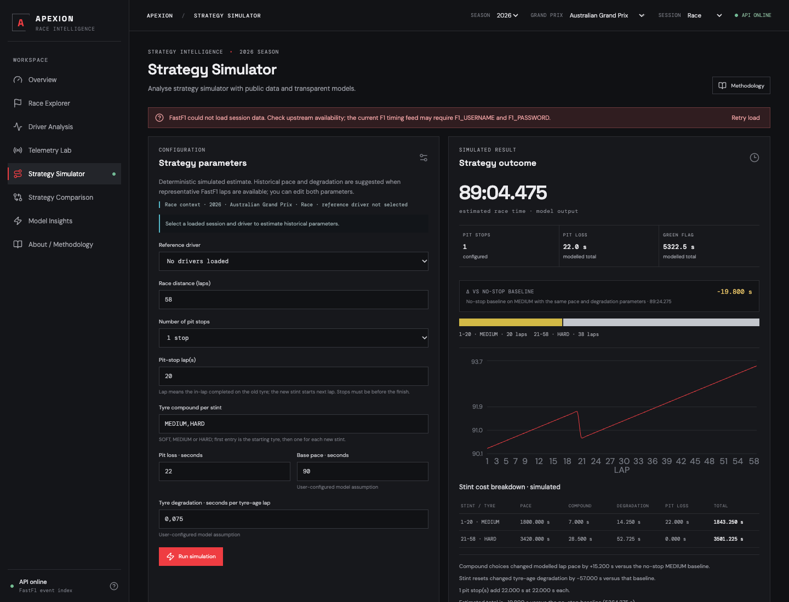
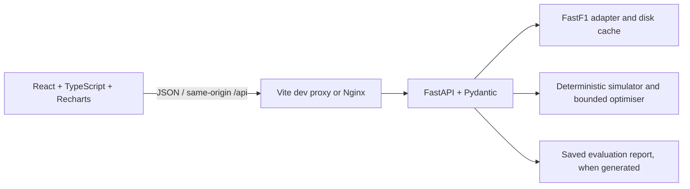

# Apexion

**Find the optimal line.** Apexion is an independent Formula 1 race analysis and strategy simulation application. It combines public historical session data from [FastF1](https://docs.fastf1.dev/) with a deterministic strategy model, documented assumptions and measured telemetry where the source provides it. It is an educational portfolio project, not a recreation of a team's proprietary tools.

## Screenshots

These images were captured from the running application in Chrome. The dashboard screenshot explicitly shows its sample fallback and FastF1's current session-data error; it does not present sample laps as historical measurements. The simulator screenshot shows a real response from Apexion's local deterministic simulation endpoint.

| Overview · desktop | Overview · mobile |
| --- | --- |
|  |  |



## What works

- Responsive workspace with Overview, Race Explorer, Driver Analysis, Telemetry Lab, Strategy Simulator, Strategy Comparison, Model Insights and Methodology sections.
- Season, event and available-session selection from the FastF1 schedule.
- Recently opened session links saved in the browser for quick return.
- Session summary, historical classification, driver laps, sector times, tyre compounds, pit laps and tyre stint summaries when present in source data.
- Lap pace plot, valid-lap filtering, median representative pace, best valid lap, interquartile range and median sector times.
- Actual telemetry channels returned for a selected lap, plus two-lap/driver comparisons aligned on their shared absolute distance overlap in metres.
- Deterministic, user-configurable strategy evaluation with historical parameter estimation when enough representative laps are available, explicit illustrative fallbacks, per-lap predictions and stint/pit-loss breakdowns.
- Bounded optimisation through three stops with an explicit candidate count and search description.
- Named strategy scenarios persisted in browser local storage, editable configuration, baseline deltas, duplicate/remove actions and CSV export.
- FastF1 cache, graceful source errors, synthetic-data unit tests and a GitHub Actions workflow.

Data coverage depends on the selected session, upstream availability and source-provided channels. Apexion queries FastF1's dynamic schedule and session loader, caches schedules in memory and relies on FastF1's disk cache for session data. In the final local verification, the 2024 schedule returned 24 events, but the Bahrain Race summary returned HTTP 503 because the upstream timing feed reported that it may require `F1_USERNAME` and `F1_PASSWORD`. The interface displays that error rather than substituting measurements. When source metadata exists without lap timing, Apexion marks the session partial. Its synthetic overview curve is explicitly labelled and shown only as a fallback.

## Technology stack

- Frontend: React 18, TypeScript, Vite, Recharts and Lucide.
- Backend: Python, FastAPI, Pydantic and FastF1.
- Testing and quality: Vitest, React Testing Library, pytest, ESLint, Ruff and TypeScript.
- Packaging: Docker multi-stage frontend image, non-root FastAPI container and Docker Compose.
- Automation: GitHub Actions runs lint, backend and frontend tests, TypeScript checks and a production frontend build.

## Run locally with one command

Requirements: Python 3.10+ and Node.js 24+.

From the project root, install locked frontend packages and the backend runtime, test and lint packages once:

```bash
npm run setup
```

Then launch the frontend and backend together:

```bash
npm run dev
```

Open <http://localhost:5173>. Both services log in the same terminal; press **Ctrl+C** to stop them together. The frontend proxies `/api` to FastAPI on port 8000. API docs are at <http://localhost:8000/docs>. The launcher reports missing dependencies and unexpected service exits, including likely port conflicts. Node 24 is the supported local and CI runtime.

FastF1 data is cached in `backend/.cache/fastf1`, created automatically and ignored by Git. Schedule requests require internet. Historical timing availability depends on FastF1 and its upstream feed; some requests may require an F1 account. If needed, export credentials in your shell before `npm run dev`:

```bash
export F1_USERNAME="your-account"
export F1_PASSWORD="your-password"
npm run dev
```

Do not commit credentials. The standard local frontend uses a same-origin Vite proxy, so `APEXION_CORS_ORIGINS` and `VITE_API_URL` can remain unset. `VITE_API_URL` is a build-time frontend setting for a separately hosted API; set `APEXION_CORS_ORIGINS` to the exact public frontend origin in that deployment.

## Run with Docker Compose

With Docker Engine/Desktop and the Compose plugin installed:

```bash
cp .env.example .env
docker compose up --build --wait
```

Open <http://localhost:8080>. The backend API docs remain at <http://localhost:8000/docs>. Compose stores FastF1 cache data in the `fastf1-cache` volume, waits for the API health check before starting the frontend, and runs the backend as a non-root user. Add optional `F1_USERNAME` and `F1_PASSWORD` to `.env` only if your FastF1 session requests require them. Compose serves `/api` through Nginx on the same origin, so leave `APEXION_CORS_ORIGINS` empty. `HOST_PORT` changes the host API port only. Stop services with `docker compose down`; the named cache volume remains available. Docker build, startup, health checks, and frontend-to-backend proxy were verified locally.

## Verify

```bash
npm run check
```

`npm run check` runs both linters, the frontend type check, backend and frontend tests, and the production frontend build. Individual root commands are available as `npm run lint`, `npm run typecheck`, `npm run test`, and `npm run build`. Tests use deterministic fixtures and do not need internet or FastF1 downloads. GitHub Actions runs those required checks on pushes and pull requests.

## Architecture



The API layer validates input and maps failures to useful HTTP responses. The FastF1 adapter handles schedules, session loading, normalisation and cache access. Simulation and optimisation calculations are kept in backend services and share the same deterministic engine.

## Deployment guide

No public deployment has been performed; there is no live URL. The verified container path is a single-host Docker Compose deployment. For a public host, place a TLS reverse proxy such as Caddy or a managed HTTPS load balancer in front of port 8080, restrict public access to the frontend origin, and persist the `fastf1-cache` volume. Do not expose F1 credentials in frontend variables or browser code.

For separately hosted frontend and API services:

1. Build and deploy the backend image from `backend/Dockerfile`. The container listens on the platform-provided `PORT` (defaults to 8000), and FastF1's cache must use writable persistent storage if it should survive restarts.
2. Set backend `APEXION_CORS_ORIGINS` to the exact HTTPS origin serving the frontend (comma-separated only if several trusted origins are required). Leave it empty when a same-origin proxy is used.
3. Set `F1_USERNAME` and `F1_PASSWORD` as backend-only secret environment variables when the upstream source requires authentication. They are optional and do not guarantee that every session is available.
4. Build the frontend image or static bundle with `VITE_API_URL=https://your-api.example.com` if it calls the API directly. For a same-origin reverse proxy, leave `VITE_API_URL` empty and route `/api` to the backend.
5. Configure the hosting platform's health check to request `/api/health` on the backend and the frontend root `/` on the frontend.

The repo's Docker Compose topology uses Nginx to proxy `/api` to FastAPI and is suitable for local use or a small single-host demonstration. Use your platform's secret manager rather than committing `.env`. The public F1 timing feed may require an account and is outside Apexion's control.

## Data and metric definitions

- Classification, lap times, sector times, tyre compounds, stint ids and available car channels are source observations from FastF1.
- `representative lap` excludes missing lap times and laps with a pit-in or pit-out marker. It does not adjust for traffic, safety cars, fuel, weather, track evolution or tire condition beyond reported tyre age.
- Driver pace uses the median of representative laps. Variability uses the interquartile range (75th percentile minus 25th percentile). Best valid lap is shown separately and is not treated as normal pace. Sector medians use the representative-lap set, omitting missing sector values.
- Paired telemetry is interpolated over the laps' shared absolute distance overlap in metres. Relative time deltas use FastF1's telemetry `Time` samples after aligning elapsed time at the overlap start. Exact lap and sector deltas come from FastF1 lap timing. Only channels present in both traces are shown.
- Braking regions use available Brake signals. Acceleration regions are derived only where measured throttle is at least 80% and measured speed increases between samples. These visual regions are descriptive cues, not calibrated corner annotations.
- Missing data remains missing. Telemetry channels are not fabricated.

## Strategy model

The lap calculation is:

```text
baseline pace + compound offset + tyre age × degradation per lap
```

Tyre age resets at a stop; every stop adds a fixed pit loss. Defaults are 90 seconds baseline pace, SOFT/MEDIUM/HARD offsets of 0.00/0.35/0.75 seconds per lap, 0.075 seconds per tyre-age lap, and 22 seconds per pit stop. Users can change pace, degradation and pit loss in the simulator. Apexion can estimate baseline pace as the median of selected-driver FastF1 representative laps after subtracting the configured compound offsets and estimated tyre-age cost. It estimates degradation as a Theil–Sen median of pairwise slopes within same-compound stints. The degradation fit requires at least 12 representative laps, at least one same-compound stint with a known stint identifier, five or more laps spanning four tyre-age steps, and 20 pairwise slopes; otherwise it uses the illustrative 0.075 s/lap default. Pace requires at least three representative laps with reported tyre age; laps with unknown age are not treated as new tyres. Otherwise it uses the illustrative 90 s/lap default. These historical fits are descriptive and do not control for fuel, traffic, weather, track evolution, neutralisations or changes in car/driver performance. Compound offsets (SOFT 0.00, MEDIUM 0.35, HARD 0.75 seconds) and the 22 second default pit loss remain configurable illustrative assumptions.

Pit convention: a selected pit lap is completed on the old compound. The next numbered lap starts on the next stint's compound with tyre age zero. Every lap, including that in-lap and the next out-lap, uses the same lap-time equation; the configured net pit loss is then added once per stop. There is no separate in-lap or out-lap penalty, preventing double counting. The displayed comparison baseline is a no-stop race on the same starting compound, baseline pace and degradation parameter. The simulator reports this difference and the actual pace, compound, degradation and pit-loss contributions. Outputs are simulated estimates, not actual results or guaranteed forecasts.

### Hand-checkable reference example

Configure 5 laps, SOFT then HARD, pit after lap 2, baseline pace 90.000 s, degradation 0.100 s per tyre-age lap and 22 s pit loss. The lap curve is `[90.000, 90.100, 90.750, 90.850, 90.950]`; green-flag time is 452.650 s, the single pit loss is 22.000 s and total time is **474.650 s**. The no-stop SOFT baseline is 451.000 s, so the modelled difference is +23.650 s. Unit test: `backend/tests/test_simulation.py::test_reference_example_can_be_verified_by_hand`.

The optimiser uses the same `simulate()` implementation as manual strategies. Candidate generation covers SOFT/MEDIUM/HARD sequences and ordered pit laps with a four-lap minimum stint, up to three stops. It first tries a deterministic spaced grid, then widens the spacing as needed to stay below a hard 5,000-candidate limit. Each candidate is validated before simulation. Results are ranked by simulated total time with deterministic tie-breaks and include candidate count, grid spacing, search scope, baseline delta and stint breakdown. It marks whether the candidate space was exhaustive within the selected stop and stint bounds; a spaced grid is not a global optimum.

Season-specific tyre-use regulations are not applied because Apexion has no verified season rule dataset. Users should treat candidates as mathematically strong within this model, not necessarily regulation-compliant. The comparison page only calculates deltas between scenarios from the same race, race distance, baseline pace, degradation, pit loss and compound-offset model. Incompatible configurations remain saved and can be inspected by selecting that scenario as the comparison group. Optimiser candidates can be added directly to comparison; manual results can be saved there as well. The comparison can be exported to CSV. No machine-learning model or accuracy claim is included.

## Model evaluation

Generate a reproducible historical evaluation report from FastF1 race timing data:

```bash
cd backend
.venv/bin/python -m app.evaluation --years 2022 2023 2024 --max-events-per-season 6
```

The command retrieves the chronologically earliest six race events per requested season (with lap timing only; it does not download telemetry), caches FastF1 data, records skipped sessions, and writes `backend/artifacts/model_evaluation.json`. Use `--max-events-per-season 0` to attempt every race in each season or `--output PATH` to choose another report path. `/api/models/metrics` and the Model Insights page read that report. Without a report, the app states “not run” and shows no metrics. No evaluation report or measured accuracy metrics are committed with this project, so no model score is claimed here.

The target is each driver's eligible green-flag lap time after three earlier eligible laps from the same held-out race have calibrated the race-specific pace intercept. Those first three laps are calibration only and are not scored. Unique races are ordered by season and round; the last 20% are held out as test races. All laps from those race IDs are excluded from the training-race tyre-degradation fit. The model uses a median pairwise within-stint, same-compound tyre-age slope fitted only on training races, plus the simulator's fixed compound offsets. The comparator predicts a constant lap time equal to the median of the same three calibration laps.

Eligibility requires a finite positive lap time, known dry compound, tyre life and stint, and `TrackStatus == 1`. Pit-in/out laps, `IsAccurate == False`, unknown/non-green track status, missing target times, unsupported compounds and missing tyre-age/stint fields are excluded. Missing accuracy flags are retained; exclusions are counted in the report. The method does not adjust for fuel, traffic, weather, car/driver changes or other residual race effects. MAE, RMSE, signed bias, median and tail absolute errors are calculated on scored held-out laps, with per-race metrics and a simple baseline comparison. The result is conditional later-lap evaluation, not cold-start or future-race validation.

No advanced machine-learning estimator is currently trained. The Model Insights page reports that decision explicitly; a more complex model should be considered only after this race-held-out baseline and its feature/validation limits justify it. Re-run the command to reproduce the report. The output records the model version, split, training/test race IDs, filters, training fit support, retrieval successes/failures and generation time.

## API and configuration

Routes validate requests and return consistent errors; session loading, data normalization and strategy calculations live in backend services. `APEXION_CORS_ORIGINS` accepts a comma-separated allowlist and allows no cross-origin browser origins by default. The standard local and Compose frontends proxy `/api` through their own origin, so broad CORS access is not needed.

## Known limitations

This version does not implement safety-car scenarios, weather simulation, regulation-aware strategy constraints, traffic-adjusted or validated pace/degradation prediction, trained machine learning, a circuit map, steering telemetry, authentication, shared/cloud scenario storage or a public deployment. Historical finishing classifications, sectors, stints, and telemetry are shown only where the FastF1 session provides them. Scenarios are saved only in the current browser. CI and local lint suppress only the React Hooks `set-state-in-effect` rule because the existing feature components use effects to synchronize loading/selection state; hook order and dependency checks remain enabled.
